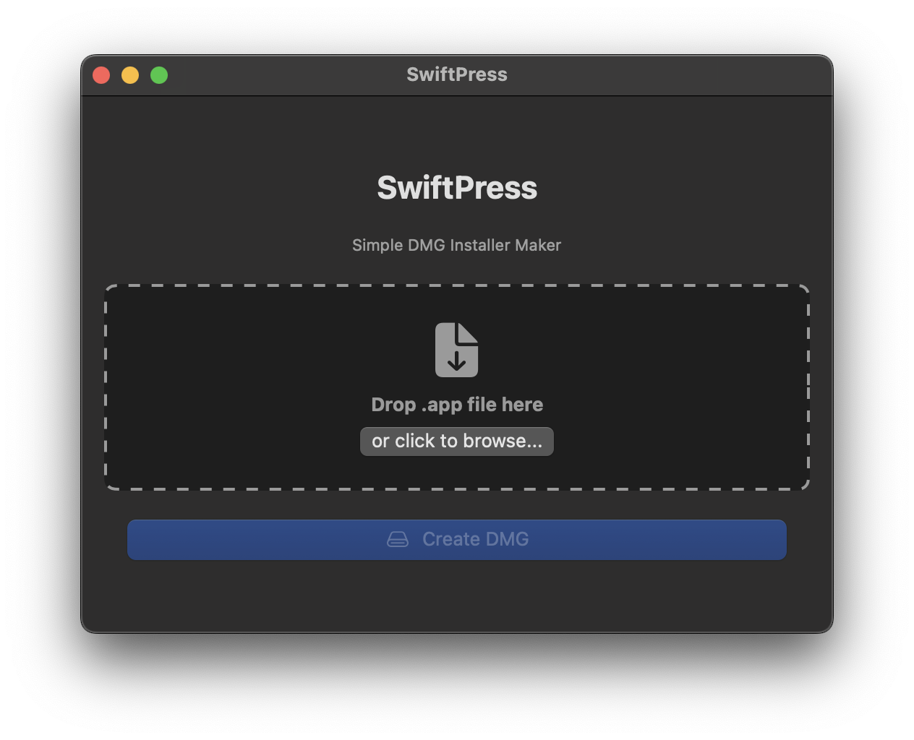

# SwiftPress

> Vibe Coding with GLM 5.1/OpenCode, thanks to Zhoumo API

A simple macOS DMG installer maker built with SwiftUI.

[中文说明](README.zh.md)



## Features

- Drag & drop `.app` file to create a DMG installer
- Automatically creates `/Applications` symlink in the DMG
- Auto-reads app version from `Info.plist` and includes it in the DMG filename
- Adds build date to the output filename (e.g. `MyApp v2.1.0 20260615.dmg`)
- Volume name matches the DMG filename
- Language switch (English / 中文)
- Appearance switch (Light / Dark / System)
- Preferences are persisted across launches

## Requirements

- macOS 13.0+
- Xcode 15.0+

## Build

### Xcode

Open `SwiftPress.xcodeproj` and build.

### SPM

```bash
swift build
swift run
```

## License

MIT
