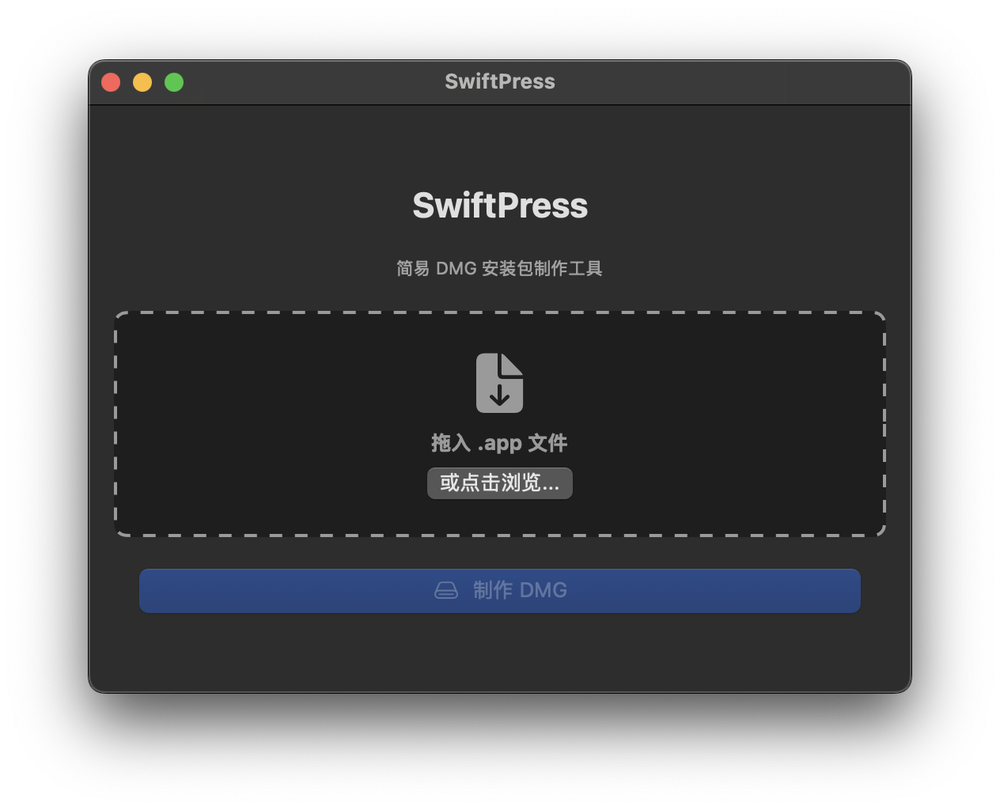

# SwiftPress

> 由GLM 5.1/OpenCode Vibe Coding而成，感谢Zhoumo API

一个简易的 macOS DMG 安装包制作工具，使用 SwiftUI 构建。



## 功能

- 拖入 `.app` 文件即可制作 DMG 安装包
- 自动在 DMG 中创建 `/Applications` 替身
- 自动读取 `Info.plist` 中的应用版本号，包含在 DMG 文件名中
- 在输出文件名中加入打包日期（如 `MyApp v2.1.0 20260615.dmg`）
- DMG 卷标名与文件名保持一致
- 中英文切换
- 外观切换（浅色 / 深色 / 跟随系统）
- 设置项自动持久化保存

## 系统要求

- macOS 13.0+
- Xcode 15.0+

## 构建

### Xcode

打开 `SwiftPress.xcodeproj` 构建运行。

### SPM

```bash
swift build
swift run
```

## 开源协议

MIT

---

[English README](README.md)
