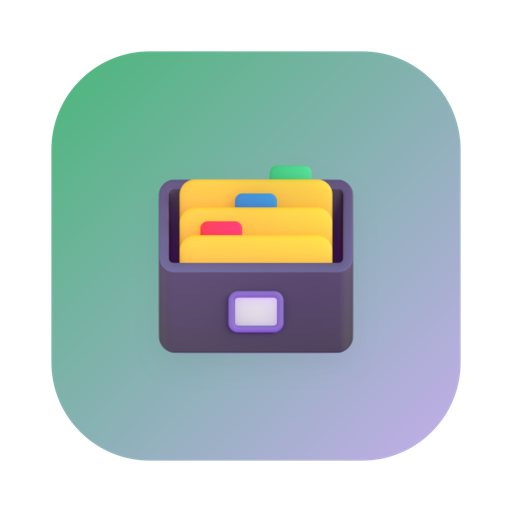
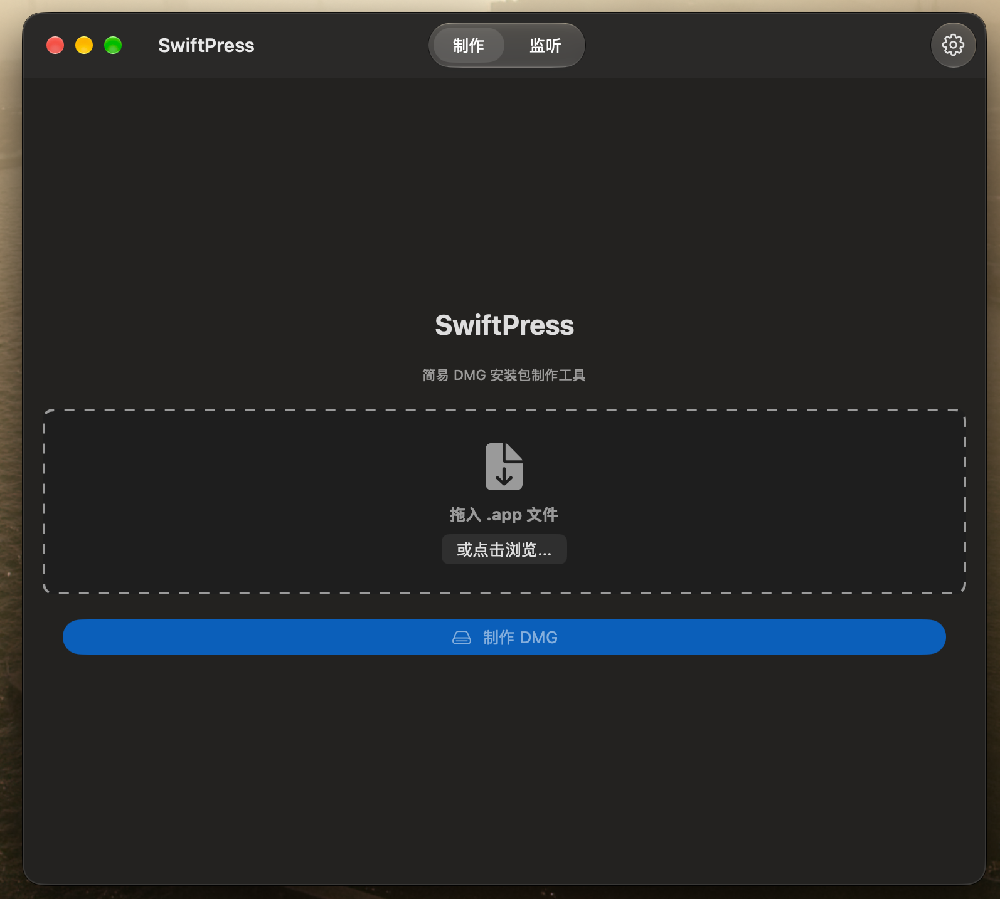

<p align="center">
  
</p>

<p align="center">
  <a href="https://www.swift.org/"></a>
  <a href="https://www.apple.com/macos/"></a>
  <a href="https://github.com/whynbnb/SwiftPress/blob/main/LICENSE"></a>
  <a href="https://github.com/whynbnb/SwiftPress/commits/main"></a>
</p>

# SwiftPress

> 由 Vibe Coding 而成（DeepSeek V4.1 Flash / OpenCode）

一个简易的 macOS DMG 安装包制作工具，使用 SwiftUI 构建。



## 功能

### 制作 DMG
- 拖入（或浏览选择）`.app` 文件即可制作 DMG 安装包
- 自动在 DMG 中创建 `/Applications` 替身
- 自动读取 `Info.plist` 中的应用版本号，包含在 DMG 文件名中
- 在输出文件名中加入打包日期（如 `MyApp v2.1.0 20260615.dmg`）
- DMG 卷标名与文件名保持一致
- 可设置打开 DMG 时的图标大小：小 64 / 中 96 / 大 128 / 超大 160，也可自定义或选择「不设置」沿用系统默认；设置会被记住
- 可设置打开 DMG 时的窗口大小：小 480×320 / 中 640×400 / 大 800×500 / 超大 1000×620，也可自定义或选择「不设置」沿用系统默认；设置会被记住
- 干净的安装器布局：自动隐藏工具栏、侧栏、路径栏和状态栏，并自动摆放 app 与 Applications 图标
- 制作在后台线程执行，过程中可随时取消

> 布局直接写入镜像，打包时不会弹出 Finder 窗口，也无需自动化权限。

### 监听目录
- 可添加多个监听目录，每个目录可单独启用/停用
- 每个目录可配置监听内容（扩展名，默认 `.app`）
- 每个目录可配置扫描深度：不扫描子目录 / 只扫描一层 / 递归所有
- 基于 FSEvents 实时更新：新文件立即出现，删除也会同步反映
- 新发现的文件带 `NEW` 标记；点击即可选为待制作对象
- 大目录在后台扫描并逐步显示结果

### 外观与语言
- 语言切换（跟随系统 / 中文 / English）
- 外观切换（跟随系统 / 浅色 / 深色）
- 设置项自动持久化保存

## 命令行

```bash
# 默认输出名（与 app 同目录，版本号 + 日期）
SwiftPress --app /path/MyApp.app

# 指定输出路径
SwiftPress --app /path/MyApp.app --output /path/MyApp.dmg
SwiftPress --app=/path/MyApp.app -o /path/MyApp.dmg

# 帮助
SwiftPress --help
```

参数：

- `--app <path>` — 待打包的 `.app`（必填）
- `--output, -o <path>` — 输出 DMG 路径（可选）
- `-h, --help` — 显示帮助

命令行会沿用主界面「高级设置」中保存的图标大小与窗口大小。

未指定 `--output` 时，DMG 默认写在 app 同目录；目录不可写时回退到下载目录；同名文件会自动追加序号（` 2`、` 3`…）。

## 实现原理

DMG 的布局是直接写进镜像的，打包过程中不调用 Finder。

- App 内置一份预生成的 `.DS_Store` 模板：隐藏工具栏、侧栏、路径栏和状态栏，使用图标视图，并按名称排列图标。
- 打包时把模板复制到 staging 目录，并按设置原地修改字节：
  - **窗口大小** — 替换 `bwsp` 记录中的 `WindowBounds` 字符串，使用等长的空格补位；`WindowBounds` 使用左下角原点，因此会按屏幕高度换算成距顶部 120pt 的位置。
  - **图标大小** — 替换 `icvp` 记录中的 `iconSize` 数值。
- 最后由 `hdiutil create -srcfolder … -format UDZO` 生成 DMG。
- 选择「不设置」时，该项交给 Finder 决定：窗口项会把 `WindowBounds` 键改名，让 Finder 使用默认窗口尺寸；图标大小则回落到 Finder 默认值（48）。

因为 `.DS_Store` 在 `hdiutil` 执行前就已写好，整个打包过程不挂载镜像，也不会弹出 Finder 窗口或请求自动化权限。

## 系统要求

- macOS 15.0+
- Xcode 16.0+（Swift 6）

## 构建

### Xcode

打开 `SwiftPress.xcodeproj` 构建运行。

### SPM

```bash
swift build
swift run
```

## 开源协议

MIT

---

[English README](README.md)
